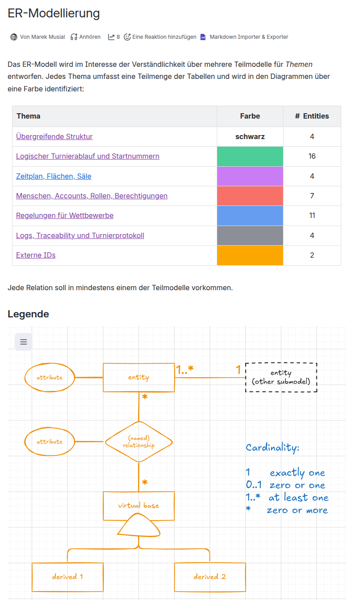

# ER\-Modellierung

Das ER-Modell wird im Interesse der Verständlichkeit über mehrere Teilmodelle für *Themen* entworfen. Jedes Thema umfasst eine Teilmenge der Tabellen und wird in den Diagrammen über eine Farbe identifiziert:

| **Thema** | **Farbe** | **#  Entities** |
| --- | --- | --- |
| [Übergreifende Struktur](https://tanzsport.atlassian.net/wiki/spaces/SD/pages/237633540/ER-Modell+bergreifende+Struktur) | **schwarz** | 4 |
| [Logischer Turnierablauf und Startnummern](https://tanzsport.atlassian.net/wiki/spaces/SD/pages/226426882/ER-Modell+Logischer+Turnierablauf+und+Startnummern) |  | 16 |
| [Zeitplan, Flächen, Säle](https://tanzsport.atlassian.net/wiki/spaces/SD/pages/226885633/ER-Modell+Zeitplan+Fl+chen+S+le) |  | 4 |
| [Menschen, Accounts, Rollen, Berechtigungen](https://tanzsport.atlassian.net/wiki/spaces/SD/pages/226885646/ER-Modell+Menschen+Accounts+Rollen+Berechtigungen) |  | 7 |
| [Regelungen für Wettbewerbe](https://tanzsport.atlassian.net/wiki/spaces/SD/pages/226951169/ER-Modell+Regelungen+f+r+Wettbewerbe) |  | 11 |
| [Logs, Traceability und Turnierprotokoll](https://tanzsport.atlassian.net/wiki/spaces/SD/pages/226885659/ER-Modell+Logs+Traceability+und+Turnierprotokoll) |  | 4 |
| [Externe IDs](https://tanzsport.atlassian.net/wiki/spaces/SD/pages/226885672/ER-Modell+Externe+IDs) |  | 2 |

Jede Relation soll in mindestens einem der Teilmodelle vorkommen.

## Legende

